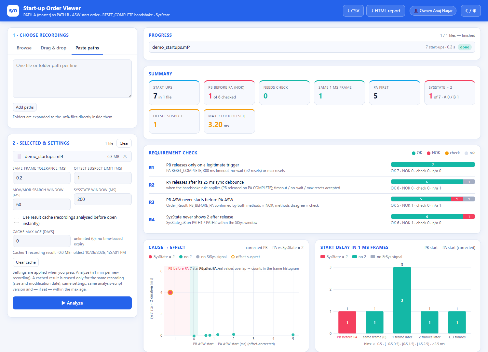
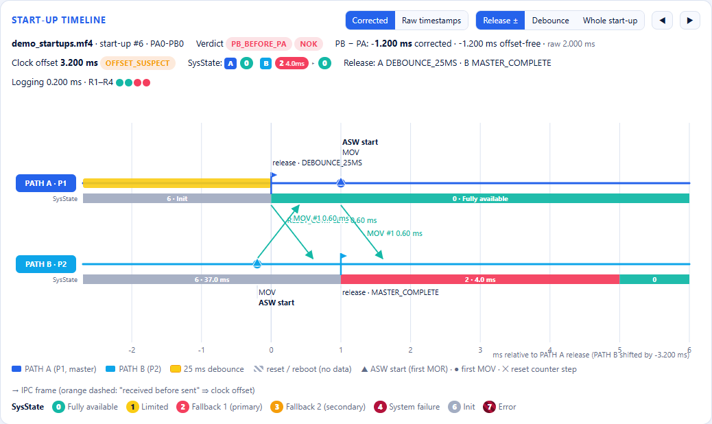

# MF4 Log Analytics: automated start-up analysis of ECU measurement logs

**Turn hours of manual log inspection into a few seconds of automated analysis.**
A Python / pandas / NumPy pipeline reads MF4 (MDF4) measurement recordings, finds every power-up, and reports for each
one which of two controller paths started first, by how many milliseconds, why each path was released, and whether the
system state misbehaved afterwards. Results come as a CSV or in an interactive browser dashboard.

> Dual-path controllers (master and slave processors with separate time bases) are hard to inspect by hand: you scroll
> through timestamps in a measurement tool, correct for clock offset in your head, and repeat that for every power-up
> in every file. This tool does it for the whole file, or a whole folder of files, in one run.

## The dashboard at a glance



Drill into any power-up. Here start-up #6 is flagged **NOK**: PATH B started 1.2 ms before PATH A once the 3.2 ms clock
offset between the two paths is removed. The raw timestamps alone (+2.0 ms) would have hidden the problem.



## What it does

| Step | What happens | Technique |
|---|---|---|
| 1. Load | Opens large MF4 files lazily, finds the two path channel groups from their acquisition source | `asammdf` |
| 2. Segment | Splits the recording into power-ups by detecting init-flag falling edges, merged within 1 s | edge detection (NumPy) |
| 3. Measure | Counts resets per path, detects reboot data gaps, finds the first application update per path | time-series event extraction |
| 4. Correct | Estimates the clock offset between the paths from matching inter-processor alive-counter pairs (linear fit against drift) | linear regression on matched counter pairs |
| 5. Cross-check | Computes a second, offset-free start difference from each path's own clock | independent validation |
| 6. Judge | Combines both methods into a verdict (`PA_FIRST`, `SAME_FRAME`, `PB_BEFORE_PA`, `INCONCLUSIVE`) and a result (`OK`, `NOK`, `CHECK`, `INFO`) | rule-based classification |
| 7. Report | One CSV row per power-up (60 columns), plus a browser GUI with charts, a timeline view and filters | pandas, HTML/JS dashboard |

Why two methods: the corrected difference depends on the offset estimate, the offset-free one does not. A verdict is
only reported as a violation when both agree, so false alarms from timestamp artefacts are filtered out.

## Quick start (no real data needed)

```bash
pip install -r requirements.txt

# 1. build a synthetic dual-path recording with 7 power-ups covering every verdict
python demo/make_demo_mf4.py

# 2. analyse it (CLI, writes a CSV)
python analyze_mf4_startup_order.py demo/demo_startups.mf4 --output demo/sample_output.csv

# 3. or open the interactive dashboard
python mf4_startup_order_gui/server.py          # http://127.0.0.1:8766
```

The demo analysis (7 power-ups, 6 MB file) takes about 3 seconds on a laptop.

Sample result on the synthetic recording (`PB - PA` is the corrected start difference in milliseconds):

| # | Scenario | PB - PA [ms] | Verdict | Result |
|---|---|---|---|---|
| 1 | clean start | +2.0 | PA_FIRST | OK |
| 2 | clean start | +0.8 | PA_FIRST | OK |
| 3 | same sample | 0.0 | SAME_FRAME | OK |
| 4 | one reset on PATH1 (PA1-PB0) | +1.2 | PA_FIRST | OK |
| 5 | one reset on both paths (PA1-PB1) | +0.6 | PA_FIRST | OK |
| 6 | PATH2 starts first, 3.2 ms clock offset | -1.2 | PB_BEFORE_PA | **NOK** |
| 7 | max resets on both paths (PA3-PB3) | +5.0 | PA_FIRST (rule not applicable) | INFO |

## Using your own recordings

Channel names are not hard-coded. Copy `config/signals.example.json` to `config/signals.local.json` (git-ignored) and
set the real channel names, IPC message indices, and the markers that identify the two paths in the MF4 source path.

```bash
python analyze_mf4_startup_order.py path/to/file.mf4                 # one file
python analyze_mf4_startup_order.py path/to/folder                   # batch, all .mf4 files
python analyze_mf4_startup_order.py file.mf4 --signals my_map.json   # explicit signal map
```

Useful options: `--same-frame-tol-ms`, `--offset-suspect-ms`, `--window-ms`, `--stsys-window-ms`. Run with `--help`.

## The dashboard

`mf4_startup_order_gui/` is a dependency-free local web app (Python `http.server` backend + a single HTML/JS front end,
bound to `127.0.0.1` only):

- drag-and-drop or browse for files and folders, batch analysis with progress
- filterable result table, summary tiles, cause-and-effect and clock-offset charts
- per-power-up timeline with resets, release reasons, IPC frames and system-state bands
- CSV export identical to the CLI, plus a printable report
- result cache keyed on file, settings, signal map and script hash, so reopening a file is instant

## Skills demonstrated

Python, pandas, NumPy, time-series and event analysis, data validation with two independent methods, rule-based
classification, large-file handling, caching, CLI design, a small REST API, and an interactive front end for
non-programmers.

## Project layout

```
analyze_mf4_startup_order.py   analysis engine + CLI
mf4_startup_order_gui/         local dashboard (server.py, index.html, run_gui.bat)
config/signals.example.json    signal map template
demo/make_demo_mf4.py          synthetic recording generator
```

## License

MIT, see [LICENSE](LICENSE).
